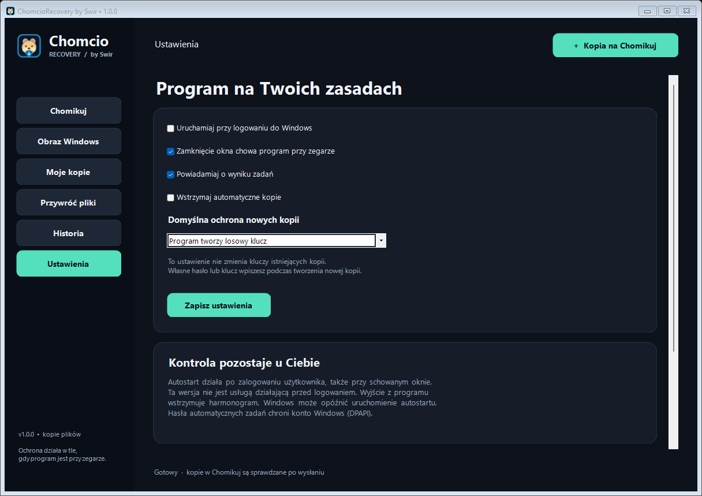
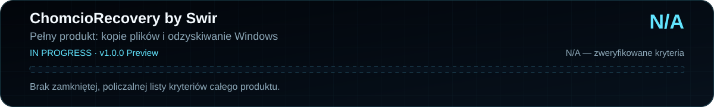

<!-- SWIR-README-STANDARD:v2 -->

<div align="center">


<br>


[](https://github.com/Swir/Chomcio/releases/tag/v1.0.0)
[](https://github.com/Swir)

# ChomcioRecovery by Swir

**Twoje pliki. Zaszyfrowana kopia. Możliwość powrotu.**

Kopie zapasowe plików i folderów na dysku oraz na własnym koncie Chomikuj —
z historią, kontrolą integralności i przywracaniem do wybranego miejsca.

[**Pobierz dla Windows x64 ↓**](https://github.com/Swir/Chomcio/releases/download/v1.0.0/ChomcioRecovery-v1.0.0-win-x64.zip) · [Pierwsza kopia](#pierwsza-kopia) · [Funkcje](#funkcje) · [Status](#status)

</div>

## 📷 Zobacz program



*Rzeczywisty ekran ustawień paczki 1.0.0 z odizolowanego testu GUI, bez danych konta.
Interfejs korzysta obecnie z WinForms.*

<a id="status"></a>
## 📍 Status projektu



**Postęp całego produktu: N/A** — brak zamkniętej, policzalnej listy kryteriów.
Liczba testów ani numer wersji nie oznaczają procentu ukończenia.

| Obszar | Stan |
| --- | --- |
| Wydanie | **v1.0.0 Preview** — GUI i CLI dla Windows x64 |
| Pliki i foldery | Dostępne: dysk i Chomikuj; [zakres wykonanych testów](VALIDATION.md) |
| Odzyskanie całego Windows | **Eksperymentalne, nieukończone jako pełny proces w aplikacji** |
| Automatyka | Opcjonalnie codziennie i po zalogowaniu, przy działającym programie |
| Dalsze prace | [Stan produktu i warunki ukończenia](docs/STATUS.md) |

W kandydacie roboczym dodano [kopie przy zamkniętym programie](docs/BACKGROUND-COPIES.md).
Lokalne wykonanie przed logowaniem i po restarcie VM oraz osobny mały test
Chomikuj przeszły kontrolę. Funkcji nie ma w publicznym ZIP v1.0.0;
pełna kwalifikacja odzyskiwania Windows nadal trwa.


<a id="funkcje"></a>
## ✨ Co potrafi Chomcio

| Funkcja | Jak pomaga |
| --- | --- |
| **Kopie i wersje plików** | Chronisz wybrane foldery i wracasz do wcześniejszej kopii. |
| **Chomikuj i dysk** | Wysyłasz kopię na swoje konto albo zachowujesz ją lokalnie. |
| **Szyfrowanie przed wysłaniem** | Chmura otrzymuje zaszyfrowane dane; folder może mieć dodatkowe hasło. |
| **Własny lub wygenerowany klucz** | Program może wygenerować i zapamiętać klucz. Możesz też wybrać własne hasło lub klucz. |
| **Zapamiętane konto** | Dane logowania i klucze zapisane na PC są chronione przez Windows dla danego użytkownika. |
| **Kontrola poprawności** | Weryfikacja danych po wysłaniu i podczas odtwarzania pomaga wykryć uszkodzoną lub niepełną kopię. |
| **Przywracanie** | Lista kopii na koncie, pobieranie i odtwarzanie z kontrolą integralności, bez cichego nadpisania danych. |
| **Praca w tle** | Ikona przy zegarze, historia, postęp, anulowanie oraz opcjonalny harmonogram. |
| **Porządek w chmurze** | Foldery z datą i opcjonalnym hasłem na Chomikuj. |

<a id="pierwsza-kopia"></a>
## 🚀 Pierwsza kopia w kilku krokach

1. [Pobierz ZIP dla Windows x64](https://github.com/Swir/Chomcio/releases/download/v1.0.0/ChomcioRecovery-v1.0.0-win-x64.zip), rozpakuj **cały folder** i uruchom `ChomcioRecovery.exe`.
2. Połącz konto Chomikuj, wybierz **„Kopia na Chomikuj”** i wskaż folder do ochrony.
3. Wybierz klucz wygenerowany przez program albo własne hasło/klucz. **Zapisz klucz odzyskiwania poza tym komputerem.**
4. Uruchom kopię i sprawdź jej wynik. Opcjonalnie włącz kopie codzienne lub po zalogowaniu.
5. Aby odzyskać dane, wybierz kopię w **„Przywróć pliki”** i wskaż nowe miejsce.

**Na innym komputerze:** połącz to samo konto, odczytaj listę kopii i użyj klucza danej
kopii. Sam login Chomikuj ani klucz zapamiętany wyłącznie na starym PC nie wystarczą
do odszyfrowania danych po awarii.

### Wymagania i pobieranie

- **Windows x64**; wydanie sprawdzono na Windows 11. Nie deklarujemy osobnej kwalifikacji wszystkich starszych wersji Windows.
- Paczka zawiera środowisko **.NET 10** — do uruchomienia nie potrzebujesz SDK.
- Kopia w chmurze wymaga własnego konta Chomikuj i połączenia z Internetem.
- EXE nie ma podpisu wydawcy Authenticode. Integralność pobrania sprawdzisz przez [sumy SHA-256](https://github.com/Swir/Chomcio/releases/download/v1.0.0/ChomcioRecovery-v1.0.0-SHA256SUMS.txt).
- [Wydanie v1.0.0 Preview](https://github.com/Swir/Chomcio/releases/tag/v1.0.0) · [Opis zmian](CHANGELOG.md) · [Weryfikacja wydania](VALIDATION.md).

## 🪟 A co z całym Windowsem?

Docelowo Chomcio ma odtwarzać również system, programy i ustawienia.
**Ta funkcja pozostaje eksperymentalna.** Kod Windows/VSS, kreator profilu i moduł
systemowy są w źródłach, ale modułu systemowego nie dołączono do paczki EXE.
Wymaga on osobnej instalacji administratora i zatwierdzonego, dedykowanego dysku
roboczego. Obraz jest najpierw przygotowywany lokalnie, a potem szyfrowany i wysyłany.

Test w izolowanych VM potwierdził utworzenie obrazu, transport przez Chomikuj,
niezależne pobranie, odtworzenie na pustym dysku i start Windows. Używał jednak
pomocniczego przekazania danych między VM a gospodarzem. **Nie potwierdza to
gotowego odzyskiwania dowolnego komputera przez GUI.** Instalator modułu, kreator
ratunkowego USB, interaktywne logowanie i pełny codzienny cykl systemowy wymagają
dalszej pracy. Szczegóły: [status i dalsze kroki](docs/STATUS.md).


## 🛠️ Technologia i budowanie

**C# / .NET 10** · **WinForms** · rdzeń kopii i szyfrowania · integracja Chomikuj ·
CLI. Moduł obrazu Windows jest osobnym komponentem. Docelowy WinUI 3 nie jest
interfejsem obecnej paczki.

Do budowania potrzebujesz Windows, **.NET 10 SDK** i **PowerShell 7**:

```powershell
pwsh -File tools/Build-Release.ps1
pwsh -File tools/Test-Standard.ps1
```

Standardowe testy korzystają ze sztucznych danych i lokalnego transportu testowego;
nie uruchamiają VM, obrazu systemu ani logowania do Chomikuj. Paczka zawiera także
`cli/ChomcioRecovery.Cli.exe`. Zasady aktualizacji grafiki: [dokumentacja README](docs/README-STYLE.md).

## 🔐 Bezpieczeństwo i ograniczenia

- Zachowaj kopię klucza poza chronionym komputerem. Zapis poświadczeń w Windows nie zastępuje klucza odzyskiwania.
- Hasło folderu w Chomikuj stanowi dodatkową ochronę; nie zastępuje szyfrowania samej kopii.
- Harmonogram plików wymaga uruchomionej aplikacji i zalogowanego użytkownika. To nie jest usługa wykonująca kopie przed zalogowaniem.
- Integracja zależy od zewnętrznej usługi. Limity konta, transfer i zmiany w Chomikuj mogą wpływać na działanie; nie zakładamy gwarantowanego oficjalnego API ani nielimitowanego miejsca. Program nie jest produktem Chomikuj.
- Nie dodawaj do repozytorium ustawień kont, kluczy, prywatnych kopii, dysków VM ani nośników instalacyjnych Windows.

## 🔎 Search Keywords

ChomcioRecovery, Chomcio by Swir, Chomikuj backup, kopia zapasowa Chomikuj,
encrypted cloud backup, szyfrowane kopie zapasowe, Windows file backup,
folder backup, backup restore, przywracanie plików, backup integrity verification,
automatic backup scheduler, Windows system tray, .NET 10 backup, C# backup application.

<div align="center">

### `BACK UP • ENCRYPT • VERIFY • RESTORE`

**ChomcioRecovery — by Swir**

⭐ Jeśli projekt Ci się przydaje, zostaw gwiazdkę.

[**← SWIR profile**](https://github.com/Swir) · [**All projects →**](https://github.com/Swir?tab=repositories)

</div>
